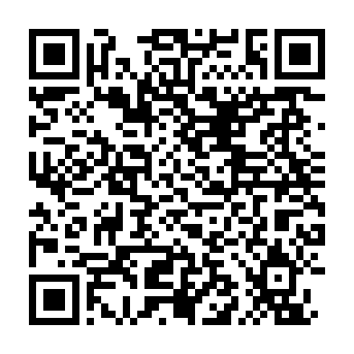

# Sonic 3 A.I.R. on New 3DS — install guide

This is an unofficial port by **heccfluffin** of [Sonic 3 A.I.R.](https://sonic3air.org) (by Eukaryot & contributors)
to the **New Nintendo 3DS / New 3DS XL / New 2DS XL**. It does not run on the original (Old) 3DS / 2DS models, which don't have enough memory and CPU speed.

The port contains **no game content**. You need two things the port can't include:
your own copy of the game's ROM, and the data files from the official A.I.R. PC release.


## What you need

| What | Where it comes from |
|---|---|
| A New 3DS / New 3DS XL / New 2DS XL with custom firmware (Luma3DS) | Follow the official guide at [3ds.hacks.guide](https://3ds.hacks.guide) |
| `sonic3air.cia` (or `sonic3air.3dsx`) | From this port's download / GitHub Actions build |
| The `data` folder of Sonic 3 A.I.R. **version 26.03.28.0** | The Windows download from [sonic3air.org](https://sonic3air.org) |
| The game ROM, named **exactly** `Sonic_Knuckles_wSonic3.bin` | Your own copy of the game on Steam (see step 3) |
| `dspfirm.cdc` (needed for sound) | Dumped from your own console (see step 1) |


> **`3ds` is not the same folder as `Nintendo 3DS`.** All paths in this guide are in the folder named `3ds`
> (lowercase) in the top level of the SD card. `Nintendo 3DS` is the console's own system data: leave it alone.
> If there's no `3ds` folder yet, create it next to `Nintendo 3DS`.


## The easy way: let the mod patcher do steps 2 to 4

The mod patcher (`s3air_3ds_modpatcher.py`, needs [Python 3](https://www.python.org/downloads/) on your PC) can set up the
game files for you:

1. Download Sonic 3 A.I.R. **26.03.28.0** for Windows from [sonic3air.org](https://sonic3air.org) (just the .zip, no need to unpack it).
2. Put the 3DS SD card into your PC and double-click `s3air_3ds_modpatcher.py`.
3. Select the SD card at the top, then click **Set up game files...** and follow the two questions:
   - pick the downloaded A.I.R. .zip: it checks the version and copies the `data` folder
   - it looks for your Sonic 3 & Knuckles ROM in your Steam library (or you pick the file): it checks that it's the
     right ROM, exactly like the game does, and copies it **under the right name automatically**
4. It then shows a checklist of everything on the SD card. Step 1 (sound firmware) still has to be done on the 3DS.

Command line alternative: `python3 s3air_3ds_modpatcher.py setup --air <A.I.R. zip> [--rom <your ROM>]`

The manual steps below do the same by hand.


## Step 1: Sound firmware (one time only)

Homebrew needs a dump of the console's sound firmware, otherwise the game has no audio.
If you have played other homebrew games with sound, you most likely have it already:
check that the file `sdmc:/3ds/dspfirm.cdc` exists on your SD card.

If it's missing: run the **DSP1** homebrew app once (it's in Universal-Updater, or on GitHub as "DSP1").
It creates `sdmc:/3ds/dspfirm.cdc` for you.


## Step 2: Game data files

1. Download Sonic 3 A.I.R. for Windows from [sonic3air.org](https://sonic3air.org).
   **It must be version 26.03.28.0**, the same version this port is built from.
2. Unpack the download on your PC and find its `data` folder.
3. Copy the whole `data` folder to `sdmc:/3ds/sonic3air/data/` on your SD card.

The folder must contain at least these files:

```
data/
├── audiodata.bin
├── enginedata.bin
├── gamedata.bin
├── metadata.json
└── scripts.bin
```

`audioremaster.bin` is optional (the remastered soundtrack). If the PC release has it, you can copy it as well.
You don't need any other files from the PC download: the `.exe`, `.dll` and `config.json` files are not used.


## Step 3: The game ROM

> **The ROM file must be named exactly:**
>
> ```
> Sonic_Knuckles_wSonic3.bin
> ```
>
> Copy the name from above to avoid typos: capital **S** and **K**, underscores (`_`) instead of spaces,
> a lowercase **w** before `Sonic3`, and the ending `.bin`.
> The game only looks for this name, so a ROM called e.g. `Sonic 3 & Knuckles.bin` or `s3k.bin` is not found
> until you rename it.

Sonic 3 A.I.R. needs the Sonic 3 & Knuckles ROM from the Steam release of the game.
Other ROM dumps get rejected because their checksum doesn't match, even when they have the right name.

If you own the game on Steam, the file is in the game's install folder, for example in the
**"SEGA Mega Drive & Genesis Classics"** collection under `uncompressed ROMs`.
(In Steam: right-click the game → Manage → Browse local files.)

Copy it to `sdmc:/3ds/sonic3air/Sonic_Knuckles_wSonic3.bin`.

**Windows tip:** Windows hides known file endings by default. If you rename the file there and type `.bin`
yourself, it can end up as `Sonic_Knuckles_wSonic3.bin.bin`, which the game doesn't find.
Turn on File Explorer → View → "File name extensions" to see the full name.

Please don't share this file with others: it's the copyrighted game itself, and everyone needs their own copy.


## Step 4: Check the SD card layout

When you're done, your SD card should look like this:

```
SD card
└── 3ds/
    ├── dspfirm.cdc                       ← step 1 (sound)
    └── sonic3air/
        ├── data/                         ← step 2
        │   ├── audiodata.bin
        │   ├── enginedata.bin
        │   ├── gamedata.bin
        │   ├── metadata.json
        │   └── scripts.bin
        ├── Sonic_Knuckles_wSonic3.bin    ← step 3
        ├── savedata/                     ← created by the game on first start
        └── themes/                       ← created by the game: your own bottom screen pictures
```

The game creates `savedata/` and `themes/` itself. Your settings, save games, save states, the log file and mods go into `savedata/`.


## Step 5: Install and start

**With Universal-Updater (easiest, and gets you updates):**

1. Open **Universal-Updater** on the 3DS (get it from [its releases](https://github.com/Universal-Team/Universal-Updater/releases) if you don't have it).
2. Open the store list (the "UniStore" menu) and add a new UniStore, either by scanning this QR code with the camera:

   

   or by entering this URL:

   ```
   https://github.com/heccfluffin/sonic3air/releases/latest/download/sonic3air-3ds.unistore
   ```
3. Select the new store "Sonic 3 A.I.R. for New 3DS", pick **sonic3air.cia (recommended)** and install it.
4. Start **Sonic 3 A.I.R.** from the HOME Menu.

To update later: open the store in Universal-Updater. When a new version is out, it shows up there;
install it the same way. Your saves and settings are kept.
Universal-Updater only installs the app: the `data` folder and the ROM (steps 2 and 3) stay your job.

**CIA with FBI:**

1. Copy `sonic3air.cia` anywhere on the SD card, for example to `sdmc:/cias/`.
2. Open **FBI** on the 3DS → SD → find the file → "Install and delete CIA" (or "Install CIA").
3. Start **Sonic 3 A.I.R.** from the HOME Menu.

The CIA is recommended because it gets the New 3DS's full memory and CPU speed.

**3dsx (alternative):** copy `sonic3air.3dsx` to `sdmc:/3ds/sonic3air/` and start it from the Homebrew Launcher.
When started this way, the game may not get as much memory, so the CIA is the better choice.

**Updating:** use Universal-Updater (see above), or install the new CIA the same way. It replaces the old version, and your saves and settings
in `savedata/` are kept.


## Controls

| 3DS | In the game |
|---|---|
| Circle Pad / D-Pad | Move |
| A, B, X, Y | Jump (all of them); in menus A confirms and B goes back |
| START | Pause / start |
| SELECT | Back |
| L / ZL, R / ZR | L and R |


## The bottom screen

While you play, the bottom screen shows:

- **The controls** on the left.
- **SAVE STATE / LOAD STATE** buttons. Tap them in a level to save your exact position and load it again later.
  Each save file has its own save state; the box below the buttons says whether the current one has a state.
  Save states only work in levels, not in menus.
- **The clock and the battery** in the title bar (a lightning bolt shows while charging).
- **STATS** in the top right: performance numbers for test builds. Tap anywhere to go back.


## The 3DS menu

The main menu has a **3DS** entry (it can be hidden in Options → System). There you can spend the
**Play Coins** you earn by walking with your 3DS (up to 10 a day) on:

- **Themes** for the bottom screen. **Time of Day** (free) follows the 3DS clock: Aurora in the morning, Blue by day,
  Sunset Glow in the evening and Starry Night after dark, using the themes you own.
  **Night Mode** (free) gives both screens warmer colors, like a night light: off, after dark (8 pm to 6 am) or always.
- **Your own pictures** as themes, for free: put 320 × 240 PNG pictures into `sdmc:/3ds/sonic3air/themes/`.
  The `README.txt` and `template.png` there show where the buttons and panels go.
- **Secrets** that you'd otherwise unlock by playing.
- **A starting shield** you get at the start of each act and after losing a life.

Play Coins are shared with the rest of the 3DS (StreetPass Mii Plaza and other games use them too).
What you bought and chose is saved in `savedata/3ds_shop.txt`.

The **Journal** tab keeps a stamp card: one stamp for each day you play (the days don't have to be in a row),
with the notification light glowing pink for it. Every full card of 7 stamps brings a **postcard** for the album
there: views of the zones (the first 14 are one from each zone, 50 in all) and funny ones, some with bosses in their
arenas, drawn from your own ROM (71 postcards in all). Select the album and press A to look closer; the first time
you open the Journal, a welcome postcard drops in. Each card also brings a little **medal** next to the clock on the
bottom screen, a **voucher** (10 Play Coins off your next purchase in the 3DS menu, used by itself) and a **bonus box**:
open it in the Journal with a Fire, Lightning or Bubble Shield or 50 rings inside (just rings if you have a starting
shield), and you get it at the start of your next act in a normal game. **Stats** shows your play time, days, Sonic's
steps (running around in the game), Play Coins spent, achievements, screenshots and postcards on one page. It's all saved in `savedata/3ds_journal.txt`.

The **Challenge** tab has **Doctor Robotnik's Daily Challenge**: three new challenges every day (easy, medium and hard,
like collecting rings in a zone, destroying badniks, finishing an act in time, without a hit or as Tails or Knuckles,
earning an extra life, finding a bonus stage, scoring points, getting all three elemental shields in one act, getting
through Hydrocity without running low on air, breaking monitors, using moves (spindashes, and the drop dash, Super
Peel-Out, insta-shield or Knuckles' glide only if you have them switched on), going Super (once you've had all the
emeralds), popping Carnival Night's balloons, or turning the lights back on in Sandopolis 2), in zones you've already reached.
The hard one can also be **Outrun your shadow**: in that act a gray copy of you with a red trail runs your exact way 2.5
seconds behind, catching up to 1.5 seconds (he only sets off once you do, waits during cutscenes, fades away in boss fights and is gone for good once the boss is beaten). His
touch is a hit - and loses that try - but Sonic's insta-shield or shield moves, Knuckles' glide, invincibility or Super
knock him back further behind (hurt, like you losing rings), and then he catches up again. As Robotnik's Special he
starts 2 seconds behind and his touch is the end. And now and then he turns up uninvited: the **Shadow
Ambush** (on the Challenge tab: off, 1% of acts - the default -, 5%, 25% or every act). A WARNING with an alarm, then the
Doomsday music, and he chases you for the rest of the act (not in bonus stages or Doomsday); giant rings and the bonus
stage stars over checkpoints stay out of reach while he's there. Reach the end of the act for a Robotnik voucher. **Egg Robo
Patrols** (also on the Challenge tab: off by default, rare, sometimes or often) send Sky Sanctuary's Egg Robos into the
other zones: one flies in, takes a clear spot at your height, waits a moment, charges its laser gun (blinking) and fires
when no wall is in between, aimed at where you're running to (a little up or down too) - three shots, then it flies off. Jump, roll or spindash into one to pop it like a badnik;
an elemental shield bounces the laser off. Half of the time **Red Eye** (the Death Egg's first boss, as it is after breaking out of
its pillar, in its own chrome colors) comes first, as a security camera: it hovers at the top of the screen sweeping towards
you, its eye following you - let it get right above you and the alarm goes off, it flashes red with anger, its nozzle
glows for a second, and it fires its laser straight down (following you slowly, so keep running) while two Egg Robos fly in from both sides. Keep
out from under it for 12 seconds and it moves on. It can be popped too, if you get up there. They count
in a normal game and Act Select. Robotnik (drawn from your ROM, in his Egg Mobile, in front of a Death Egg hall) taunts you about each one and laughs
at you (shaking, squashing and stretching with each hop), jumps out to stomp mad (with dust flying) once it's beaten, and sulks when you've beaten them all. Every beaten challenge gives XP to your **Robotnik medal** (10, 20 or 30). Its first level takes 50 XP, each one after
that 10 more (up to 150), and every level gives you a voucher. Its metal goes bronze (levels 1-4), silver (5-9), gold (10-14), diamond (15-19), platinum (20-25) and emerald
(26 on), with a new rank every two levels up to "Robotnik's Nightmare" - and past that it never stops: the rank gets
numbered (II, III, ...), sparkles circle the medal (one more each level) and stars appear on its ribbon (one every 5
levels, changing color every three). At level 10 an **Expert** challenge (40 XP) joins the daily ones, and at level 20
**Robotnik's Special** (50 XP). Press A on a challenge to pin it: it then shows on the main menu (bottom left) with
your progress, until it's beaten. The notification light glows red when you beat one. Saved in `savedata/3ds_challenges.txt`.

**Screenshots:** press L and R together to save the top screen as a PNG in `sdmc:/3ds/sonic3air/screenshots/`.


## Mods

Use the mod patcher (`s3air_3ds_modpatcher.py`, see its README) with the SD card in your PC.
It copies mods to the right folder, unpacks zip files, and turns them on.
You can also copy mod folders to `sdmc:/3ds/sonic3air/savedata/mods/` yourself and enable them in the game's Mods menu.

Prefer unpacked mod folders over `.zip` files on the 3DS: the game keeps everything it reads from a zip in RAM,
which is limited on the console. The patcher unpacks zips for you.


## Troubleshooting

| Problem | What to do |
|---|---|
| "Game data not found" | The `data` folder is missing or in the wrong place: it must be `sdmc:/3ds/sonic3air/data/` (step 2). |
| "Failed to load 'scripts.bin'" | The data files are from another game version. Use the data from **version 26.03.28.0** (step 2). |
| The game asks for the ROM / "ROM could not be loaded" | Check that the file is named **exactly** `Sonic_Knuckles_wSonic3.bin` (not `.bin.bin`), is directly in `sdmc:/3ds/sonic3air/`, and comes from the Steam version (step 3). |
| No sound | `sdmc:/3ds/dspfirm.cdc` is missing (step 1). |
| The game doesn't start at all on an Old 3DS / 2DS | Only New 3DS models are supported. |
| Anything else | The game writes a log to `sdmc:/3ds/sonic3air/savedata/logfile.txt`. Include it when you report a problem. |


## Playing in an emulator (Citra / Azahar)

1. Turn on **New 3DS mode** in the emulator's system settings.
2. Open the emulator's SD card folder (File → Open Citra Folder → `sdmc`).
   Inside it, create the `3ds/sonic3air/` folder and copy the files there exactly as in step 4.
3. Install the CIA via File → Install CIA, then start it from the game list.

Performance in emulators depends a lot on the emulator's CPU clock setting and on your PC,
so it doesn't tell you how fast the game runs on a real console.


## Current state of the port

- Test builds include a performance profiler (STATS on the bottom screen). It writes its numbers to
  `savedata/profile_log.txt` and doesn't change how the game plays.
- Rendering is done mostly on the CPU; the 3DS's GPU shows the finished picture.
  Performance work is ongoing, so speed differs between zones.
